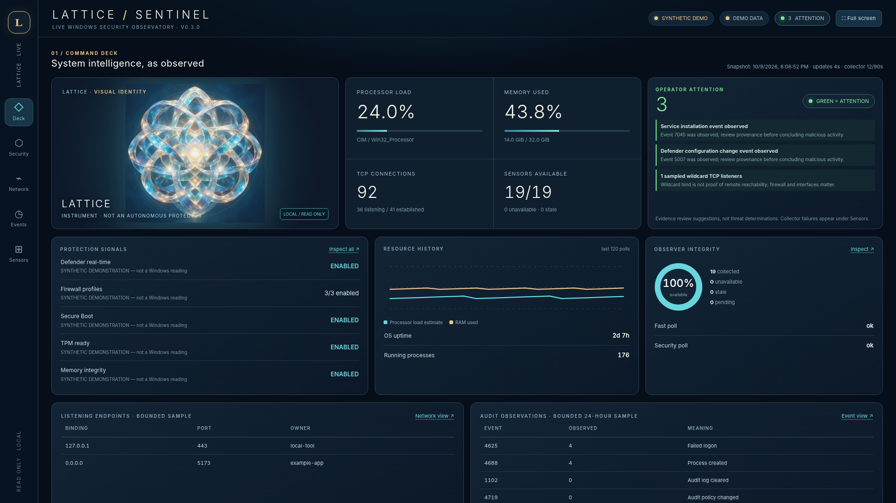

# Lattice // Sentinel — Windows Live Security Dashboard v0.3.0

**Purpose:** a read-only, local-first, full-screen Windows observability dashboard using Windows PowerShell and CIM providers. The default launch uses **real readings**. The application does not require third-party Python packages or an Internet connection.

Lattice // Sentinel brings nineteen sensor groups into a single interface: a
command deck, protection settings, network observations, bounded event samples,
and source diagnostics. Each reading keeps its source and evidence state so
that unavailable, stale, or failed collection remains visible. The dashboard
offers observations and review triggers; it does not change Windows settings.



*Synthetic demonstration preview. These values are not measurements of a
Windows host.*

## Privacy and repository boundary

This repository contains application source, tests, project artwork, and
explicitly synthetic demonstration screenshots. Python caches, collected
snapshots, local environment files, keys, logs, and common capture/export
directories are excluded by [.gitignore](.gitignore). Ignore patterns cannot
identify every possible form of private data.

The collector omits the unused top-level computer-name field. Account sensors
return counts, not account names; ASR exclusions are counted without collecting
their values; BitLocker readings exclude keys and recovery passwords. Event
message bodies and full process command lines are not collected.

**Live readings are not automatically anonymized.** Network addresses,
process names and IDs, adapter aliases, system versions, event times, and
collector error text can identify a machine or its activity. Source inspection
and **Copy current JSON snapshot** expose that evidence locally. Review copied
JSON and live screenshots before sharing them.

The server remains bound to IPv4 loopback and provides no local-client
authentication. Repository privacy does not provide isolation between programs
running on the same machine. The application has no configured telemetry-upload
service, hosted account system, or remote deployment.

## Run on Windows

1. Clone this repository or extract a source archive to a folder you control.
2. Use Windows 10/11 with Windows PowerShell 5.1 and **Python 3.10 or newer** installed.
3. Double-click **`START_WINDOWS.bat`**. A console will remain open and your default browser will open a URL such as `http://127.0.0.1:49123/`.
4. Click **Full screen** in the top right, or press **F11**. Browse Deck / Security / Network / Events / Sensors using the left rail.
5. The fast polling cycle is 12 seconds; security readings refresh every 90 seconds. Some first readings may take over a minute. Press Ctrl+C in the console to stop.

**Operator attention is GREEN.** It indicates a decision or investigation request, not a healthy machine. Cyan means normal instrument presentation. Red marks collector failure/disconnection. The interface never treats unavailable sensor data as a successful protection reading.

No administrator elevation is automatically requested. Start without elevation first; inaccessible sensors are **UNAVAILABLE** with their specific reasons, not `false` or `0`. If you choose to restart from an elevated terminal, review the implications of granting PowerShell elevated access; elevated execution is not required for all readings.

**PowerShell execution policy:** The application does not change it, disable protections, or launch `-ExecutionPolicy Bypass`. If Windows blocks downloaded scripts, confirm that the archive and script are trusted and inspect `Collect-Lattice.ps1` before deciding whether to allow execution under your own policy. Errors appear on the Sensors tab and in the local console.

### Manual PowerShell collector test

From a PowerShell prompt in the project folder:

```powershell
.\Collect-Lattice.ps1 -Mode fast -OutputPath "$env:TEMP\LatticeFast.json"
Get-Content "$env:TEMP\LatticeFast.json" | ConvertFrom-Json | Select-Object -ExpandProperty sensors

.\Collect-Lattice.ps1 -Mode security -OutputPath "$env:TEMP\LatticeSecurity.json"
Get-Content "$env:TEMP\LatticeSecurity.json" | ConvertFrom-Json | Select-Object -ExpandProperty sensors
```

These optional commands **write two output JSON files to the specified TEMP paths**; they do not change Windows policy. The dashboard itself uses random, temporary files that are deleted after parsing. The manually created files can contain potentially sensitive system details: delete them when no longer needed.

### Demo for presentation only

`PREVIEW_DEMO_WINDOWS.bat` launches an **explicitly labeled synthetic demonstration**. Synthetic readings are **never** used by the default live launch. The included screenshots are also labeled synthetic.

You can also start that presentation mode explicitly:

```powershell
python launch.py --demo --no-browser --port 8766
```

Open `http://127.0.0.1:8766/` locally. This mode uses the synthetic data in
`demo_sensors()` and does not invoke the Windows collector.

## Nineteen real sensor groups

| Collection | PowerShell interface | Actual data and limits |
|---|---|---|
| Fast: system | CIM `Win32_OperatingSystem`, `Win32_Processor` | CPU load estimate, physical RAM, OS build, uptime |
| Fast: disks | CIM `Win32_LogicalDisk` | Fixed-drive capacity/free space (not an integrity measure) |
| Fast: processes | `Get-Process` | Process count, largest working sets, cumulative CPU seconds; some process details may be restricted |
| Fast: network | `Get-NetTCPConnection`, `Get-NetAdapter` | TCP state counts, up to 30 listeners/30 connections, owning PID, adapter link states; no DNS lookups |
| Security: defender | `Get-MpComputerStatus` | Antivirus, real-time and tamper status, signature timestamp/version |
| Security: ASR | `Get-MpPreference` | ASR configured rules/modes; counts only for exclusions, never values |
| Security: firewall | `Get-NetFirewallProfile` and `Get-NetFirewallRule -PolicyStore ActiveStore`, `Get-NetConnectionProfile` | Effective profile settings, counts of enabled rules, current network categories; not packet-level enforcement proof |
| Security: Secure Boot | `Confirm-SecureBootUEFI` | Boot protection as reported locally; may fail on legacy BIOS |
| Security: TPM | `Get-Tpm` | Presence, ready, enabled/activated state |
| Security: VBS | CIM `Win32_DeviceGuard` | VBS running state, HVCI/memory integrity, Credential Guard |
| Security: BitLocker | `Get-BitLockerVolume` | Volume protection/encryption percentages; **no recovery secrets** |
| Security: accounts | `Get-LocalUser`, `Get-LocalGroupMember` | Count of local users and group memberships; **no account names** |
| Security: hotfix | `Get-HotFix` | Recent records for quick review; not a complete patch-compliance list |
| Security: Security events | `Get-WinEvent` Security (24 h, cap 250) | Select event IDs 4625, 4688, 1102, 4719, 4720, 4732, 4698; audit policy can cause absences |
| Security: System events | `Get-WinEvent` System (24 h, cap 100) | Service installation event 7045 |
| Security: Defender events | `Get-WinEvent` Defender/Operational (24 h, cap 100) | Detection 1116, action 1117, setting change 5007 |
| Security: services | `Get-Service` | Selected status: WinDefend, MpsSvc, EventLog, wuauserv, WinRM, RemoteRegistry, TermService, LanmanServer |
| Security: event channels | `Get-WinEvent -ListLog` | Security/System/Defender channel enabled state, log size/record metadata where accessible |
| Security: SMB | `Get-SmbServerConfiguration` | SMBv1/v2, signing requirement, reported encryption setting |

All errors are individually captured. A sensor can be `ok`, `unavailable`, `stale`, `starting`, or a mode can be `error`. Sensor source and raw JSON can be inspected in the dashboard. A channel marked enabled does not prove an audit subcategory is enabled; events and network sockets alone cannot prove an attack or a security property.

### Important instrumentation limitations

- The dashboard is **not** an EDR, anti-malware engine, write blocker, independent security attester, or policy enforcer.
- Windows-reported settings are not independent verification of firmware, kernel, or hardware protections.
- No guaranteed account quota/ChatGPT message-budget readings. ChatGPT does not expose those to this local application.
- The Security event-log sample is deliberately bounded to 250 matching events per query. When saturated, counts are **lower bounds**, and even an unsaturated query only counts events *recorded*, not unrecorded activity. We do not collect event message bodies or full process command lines.
- Host protections and cmdlet availability differ by Windows edition, patch level, security provider and permissions. Unsupported output is **unknown**, never simulated.
- No Group Policy miner is included. The firewall ActiveStore view reads the effective firewall configuration but does not enumerate or modify GPOs.
- TCP `0.0.0.0` / `::` listeners are not evidence of reachability from outside the host: firewall, routing, interface and network boundary matter.
- All readings use the privileges of the user who launched the app. The app binds only to `127.0.0.1`; other programs running on that machine may still connect to the local HTTP port. The dashboard does **not** authenticate local clients or provide account-level isolation. Run only on a trusted local machine, and do not forward the port.
- Windows-native sensor verification remains outstanding for this repository
  preparation. The existing Python tests and passive PowerShell parsing were
  checked on Windows without executing live collectors. All included dashboard
  screenshots come from **synthetic demo mode**, not Windows sensor measurements.

## Implementation

- `Collect-Lattice.ps1`: actual read-only Windows sensor implementation, two collection modes.
- `telemetry.py`: launch/timeout controls; receives PowerShell JSON through temporary files; rejects wrong schema/overlarge output; bounded trend history; derives cautiously worded local review triggers; conservatively marks stale data.
- `launch.py`: Python standard-library local HTTP server. No mutating HTTP endpoints, no remote bind, no internet calls, Host-header restriction and no CORS allowlist.
- `index.html`: full-screen responsive dashboard with Deck, Security, Network, Events, Sensors views and inspector. No external JS/CSS libraries.
- `assets/LATTICE_ID_PORTRAIT.png`: the project's geometric Lattice visual identity.
- `tests/test_telemetry.py`: regression suite (sensor inventory, missing evidence, stale data, read-only HTTP, demo gating, derived alerts).

### Polling/overhead control

Fast sensors are collected every ~12 seconds; security sensors every ~90 seconds. Polls have hard timeouts (33s/75s), and can overlap only across their two modes. Only the most recent bounded history stays in RAM; network lists are bounded, and raw data is not written to a persistent log. Some Windows cmdlets can be expensive, so review CPU/memory impact during first deployment. No control path will change Windows security settings.

## Debugging

1. If **all 19 sensors** remain unavailable, inspect the **Sensors** view for `PowerShell` exit codes, execution policy, missing executable or JSON errors.
2. If one sensor is unavailable, use the **Inspect source** link; the reason returned by that cmdlet is shown.
3. If the browser does not open, use the printed localhost URL in the console.
4. If a source requires elevation, the app does not silently elevate; you decide whether that particular measurement justifies extra permission.
5. If the fast or security collector exceeds its timeout, the last successful readings become **stale** instead of being presented as current.

## Provenance, scope, and status

This snapshot contains the v0.3.0 Windows sensor dashboard. Group Policy
analysis, hardware assurance, and worker federation remain deferred. The
repository-preparation change removes unused computer-name output and adds
privacy documentation without changing sensor meanings or collection timing.

## Development and validation

Clone the private repository using an account with access:

```powershell
git clone https://github.com/dastardlyrat/LatticeSecurityDashboard.git
cd LatticeSecurityDashboard
python -B -m unittest discover -s tests -v
```

The ten existing tests cover the sensor inventory, explicit demo gating,
review triggers, missing and stale evidence, failed polling, event sample caps,
and the read-only HTTP interface. They do not establish that live Windows APIs
succeed or that reported protection settings are independently effective. The
non-Windows branch test is conditional; it is also checked separately with a
mocked platform during repository preparation.

Use Python 3.10 or newer. Application operation and the Python test suite use
the standard library; Node.js is optional for checking the inline JavaScript.
No dependency installation is required for these checks.

### Cloud development boundary

The private GitHub repository can serve as the source for later development.
In a non-Windows environment, real Windows sensors remain unavailable; explicit
demo mode and the Python tests provide synthetic development paths. A remote
environment does not gain access to another computer's Windows telemetry by
cloning this repository. Remote sensor transport, authentication, and hosting
are outside this snapshot.

### Contributor entry points

- Change sensor collection in [Collect-Lattice.ps1](Collect-Lattice.ps1).
  Preserve the distinction between a successful measurement and unavailable
  evidence, and avoid adding identifying values without a documented need.
- Change polling, validation, stale-state handling, and derived review triggers
  in [telemetry.py](telemetry.py). Extend the [existing tests](tests/test_telemetry.py)
  when changing those contracts.
- Change presentation in [index.html](index.html), keeping synthetic mode,
  evidence sources, and collection failures visible.
- Change HTTP serving in [launch.py](launch.py), preserving the loopback and
  read-only boundary unless a separately designed transport replaces it.

No standalone project license file is currently included.
